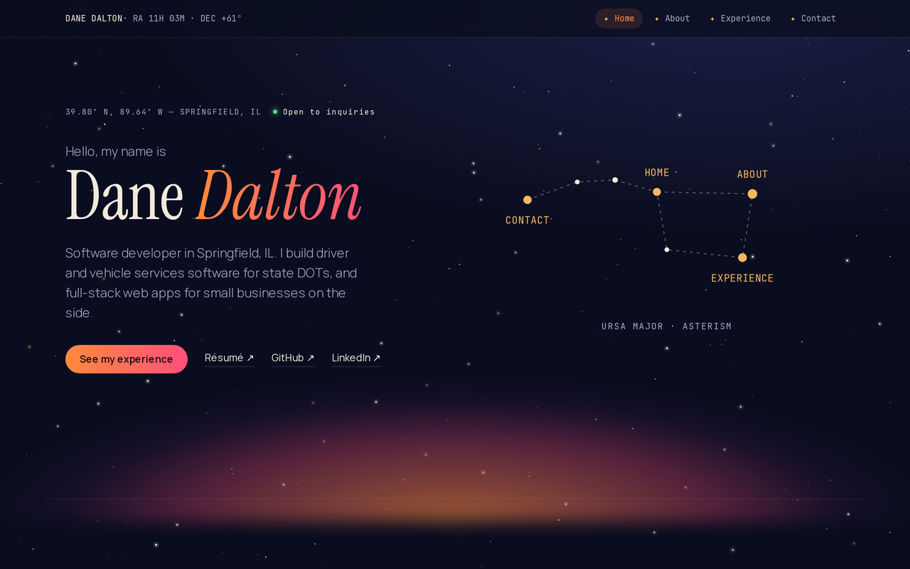

# danezdalton.com

My personal portfolio: a single page under a night sky, with a twinkling starfield, a sunset glow on the horizon, and a Big Dipper whose stars link to each section.

**Live:** https://www.danezdalton.com



The first version of this site (2024) was React + Vite and taught me TypeScript. This rebuild is in Astro and taught me Astro: the notes I kept along the way are in [`docs/astro-notes.md`](docs/astro-notes.md).

## Stack

- **[Astro 7](https://astro.build)**: pages are prebuilt to static HTML; only the contact form runs on a server.
- **TypeScript** (strict) and **Tailwind CSS 4**, with the color palette and type scale as theme tokens in `src/styles/global.css`.
- **Content collections** for jobs and projects, validated by schemas at build time.
- **Motion** (`motion/mini`) for the load sequence and scroll reveals, about 4 KB.
- **Astro Actions** + **Resend** for the contact form, deployed as a Vercel Function.
- **Vercel** hosting. No React on the page; a few small TypeScript scripts handle the starfield, navigation and form.

Lighthouse (mobile): Accessibility 100, Best Practices 100, SEO 100, Performance 97+.

## Run it locally

Requires Node 24.

```bash
npm install
npm run dev
```

The site runs at http://localhost:4321.

The contact form needs these in a `.env` file (and in Vercel's environment variables for deploys):

```bash
RESEND_API_KEY=        # Resend API key with sending access
CONTACT_TO_EMAIL=      # where messages are delivered
# CONTACT_FROM_EMAIL=  # optional; defaults to contact@danezdalton.com
```

Without them, the site builds and runs; the form shows an error instead of sending.

| Command           | What it does                          |
| ----------------- | ------------------------------------- |
| `npm run dev`     | Dev server with hot reload            |
| `npm run build`   | Type-check, then build for production |
| `npm run preview` | Serve the production build            |
| `npm run lint`    | ESLint, including accessibility rules |
| `npm run format`  | Format with Prettier                  |

## Editing content

All wording lives in data files, not in the components.

**Add a job:** create a file in `src/content/experience/`, for example `new-company.yaml`:

```yaml
company: New Company
location: Springfield, IL
url: https://example.com # optional
order: 1 # position in the timeline, lowest first
roles:
  - title: Software Engineer
    start: "2027-01"
    end: present # or a date like "2028-06"
    bullets:
      - What you built, and the result.
tech: [TypeScript, Astro]
```

Bump the `order` of the other jobs if it should go first. If a field is missing or misspelled, the build stops and names the file and field.

**Add a project:** create a file in `src/content/projects/`. Set `featured: true` to show it as a card under Selected projects:

```yaml
name: Project name
summary: One sentence about what it does.
tech: [React, Supabase]
liveUrl: https://example.com # optional
repoUrl: https://github.com/dane-dalton/example # optional
experience: new-company # optional: links the card to that job
featured: true
order: 1
```

**Everything else:**

- Name, pitch, location and links: `src/data/site.ts`
- About bio and skills: `src/data/about.ts`
- Contact wording: `src/data/contact.ts`
- Headshot: `src/assets/photoOfMe.png` (Astro resizes it at build time)
- Résumé: replace `public/Dane_Dalton_Resume.pdf`; the link stays the same

## Project layout

```
src/
  pages/        index.astro (the page), 404.astro, contact/sent.astro (no-JS form result)
  layouts/      BaseLayout.astro: <head>, SEO tags, fonts, starfield, motion
  components/   Header, Footer, BigDipper, Starfield, sections/ (Home, About, Experience, Contact)
  content/      experience/ and projects/ YAML files; schemas in content.config.ts
  data/         site.ts, about.ts, contact.ts
  actions/      the contact form action
  scripts/      motion.ts
  styles/       global.css: Tailwind and theme tokens
public/         résumé PDF, share image, favicons, robots.txt
docs/           redesign plan, content, Astro notes, screenshots
```

## Deploying

`main` deploys to danezdalton.com on Vercel. Work happens on `staging` (or a branch off it), which gets its own preview URL; `staging` is merged into `main` to go live.

## How I built it with Claude

I rebuilt this site with [Claude Code](https://claude.com/claude-code), Anthropic's coding agent, as a pair programmer. I made the decisions; Claude drafted options, wrote most of the code, and tested it. Here's how we split the work.

**Planning**

- I described what I wanted: one page with Landing, About, Experience and Contact; the space and sunset theme from the old site; the Big Dipper as navigation. I shared a couple of portfolios I liked.
- Claude mocked up theme drafts as interactive pages. I picked one, asked to combine it with the sunset colors from another, then chose the final "Horizon Chart" look.
- We compared stacks. I chose Astro over staying on React, and left React out entirely.
- Claude wrote [`docs/redesign-plan.md`](docs/redesign-plan.md): ten phases, each with its own prompt, plus a list of open questions. I answered them (contact form instead of a mailto link, dark only, headshot in About, "open to inquiries" without looking like I'm job hunting, which details stay résumé-only).
- Claude pulled my experience together from my résumé and LinkedIn into [`docs/content.md`](docs/content.md). I corrected and approved the wording before any of it went on the page.

**Building**

- Each phase ran from its prompt on its own branch off `staging`. I reviewed the result, and only said "merge it" and "push it" once I was happy. Nothing went to `main`, which deploys straight to the live site.
- Since I was learning Astro, Claude ended every phase with notes on the Astro concepts it used and why. Those are in [`docs/astro-notes.md`](docs/astro-notes.md).
- With my OK, Claude also fixed setup outside the code: the Vercel Node version (the cause of the failing builds), and the DNS records for sending email through Resend.

**Testing**

- After each phase: `npm run build` (type-check and build) and `npm run lint` (including accessibility rules) had to pass.
- Claude checked every phase in a browser at desktop and phone sizes, and compared it against the design.
- The contact form was tested end to end on a Vercel preview, including spam traps and the no-JavaScript fallback. A real message arrived in my inbox before we called it done.
- Lighthouse audits on mobile, fixing what they found (input border contrast, accessible link names) until Accessibility, Best Practices and SEO reached 100.
- Cross-browser checks with Playwright in Chromium, Firefox and WebKit (the engine behind Safari), at desktop and phone sizes.

## Contact

Use the form at [danezdalton.com/#contact](https://www.danezdalton.com/#contact).
